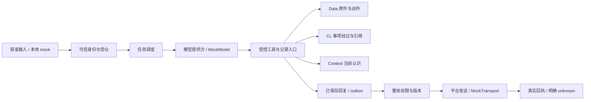

# Loom Team AI

[](LICENSE)

我想做的是一个能把事情接着做下去的 bot 工作框架。隔一天、换个会话，之前说过什么、改过什么、为什么这样做，都应该能找回来。回复不能只靠模型说“完成了”，还要有保存记录和实际回执。

这里放通用实现、设计说明和合成演示。我把真实团队的身份、聊天、配置和运行数据留在部署环境，公开仓库从一份干净快照开始。


截图来自本地模拟模式，人员、服务和模型均为合成示例。

## 先试一下

需要 Python 3.12+。最小演示不需要第三方包、平台账号或真实模型。

```sh
python examples/local_demo.py
python tools/run_tests.py --quick
```

我写了一个 [几分钟最小示例](docs/quickstart.md)：从保存一条合成介绍，到跨任务找回、权限检查、保存后发送和状态不明时拒绝重发。这里的模型和回执都是 mock。离线演示、核心检查和完整测试已在 Windows 与 Linux 验证，实际结果和环境差异见 [测试说明](docs/testing.md)。

## 整体怎么走




模型理解意思、决定采用哪些资料。程序检查身份、权限、版本和实际动作。代码检查通过，不等于模型理解一定正确。

## 我怎么组织记录

Loom 采用 ANC 三层记录设计。`anc` 包名、既有命令和备份路径保留兼容；项目名是 Loom。

| 层 | 保存什么 | 什么时候用 |
|---|---|---|
| Data | 原始消息、实际动作和结果 | 找原话、查当时发生了什么 |
| CL | 一件事的经过和逐次采用的资料 | 接着处理旧事、理解来龙去脉 |
| Context | 有来源的当前认识 | 找成员、职责、对象和当前状态 |

不要求一段内容存三遍。更正要留住旧版本，摘要不能替代原件。回复先完整保存，再发送；状态不明时保留 `unknown`，不会换个编号盲目重发。

每个 bot 有可信的独立身份，群里给它起的称呼另存。同一会话保持处理顺序，独立会话可以并发；bot 容量和共享模型资源容量分别限制。七路是可配置的席位数，实际吞吐还受模型提供方和机器资源影响。

## 当前状态

这是开发版。已有记录、权限、调度、主动私聊、图片接续、当前群按需历史和报表相关实现。离线演示能独立运行；接真实平台需要另外配置身份、范围、依赖和账号，并验收实际结果。

我还没完成排队补充自动并入当前工作、私聊统一指挥跨群操作、新控制台接线，以及其他模型提供方适配。完整范围见 [当前状态](docs/status.md) 和 [路线图](ROADMAP.md)。

### 团队共享要先讲清楚

`team_open` 在公开示例中默认关闭。只有管理员明确启用、相关成员知道并确认范围时，才适合用于需要互相接续工作的团队。开启会允许已核验活跃成员读取其他成员已进入系统的资料，**包括私聊来源和已有历史**。这不是自动采集许可；关闭也不会收回已经披露的内容。[适用前提、风险和关闭命令](docs/sharing.md) 都写在这里。

## 看理念，还是看代码

| 目录 | 我放了什么 |
|---|---|
| `theory/` | 为什么这样设计、职责、取舍和验收要求；只看理念从这里开始 |
| `framework/` | 当前实现：控制、记录、调度、接入、规则、技能、模板、工具和测试 |
| `examples/` | 不联网的最小演示和对应检查 |
| `docs/` | 上手步骤、架构、模拟截图、策略、限制和测试结果 |

理论是设计依据，代码是它的一份实现。理论里写着要做到的事，不自动算成已经做到；实现和限制要看代码、测试及当前状态说明。完整内容和排除范围见 [CONTENTS.md](CONTENTS.md)。

## 测试和许可

```sh
python tools/run_tests.py --json output/tests.json
```

怎么跑、实际通过数量、环境跳过原因和未完成的预期失败，见 [测试说明](docs/testing.md)。我不把离线检查当作真人对话已经验收。

项目自有内容采用 [Apache 2.0](LICENSE)，其中包含贡献者可授权范围内的专利许可，详见 [官方条款](https://www.apache.org/licenses/LICENSE-2.0)。第三方材料保留各自条款，见 [NOTICE](NOTICE) 和 [第三方说明](framework/THIRD_PARTY_NOTICES.md)。如何参与见 [CONTRIBUTING.md](CONTRIBUTING.md)。

## English summary

Loom is a development-stage framework for continuing bot-assisted work across conversations. It separates immutable source records (Data), case history with citations (CL), and evidence-backed current understanding (Context). Trusted host code checks identity, audience, versions, and delivery receipts.

The standard-library demo runs offline with synthetic data, a fixed MockModel, and a MockTransport. Real platforms and model providers require separate configuration and validation. Team-wide sharing is opt-in and includes private-source records when enabled; see the documented limitations and revocation procedure.
