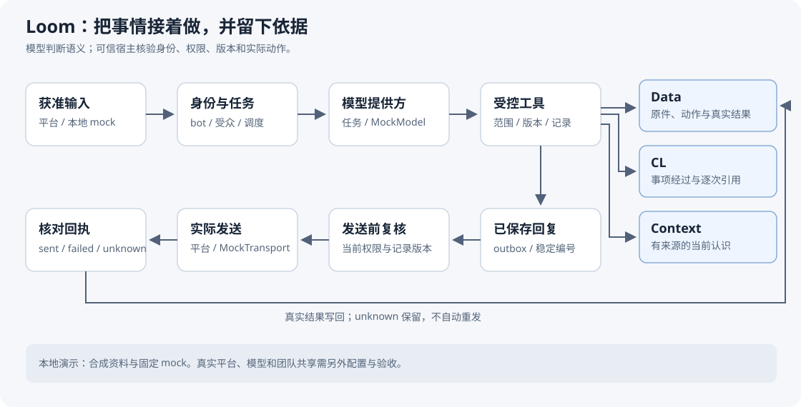

# Loom

> 当你要把 AI 助手放进一个有真人、有权限、有责任的团队，真正的难题不是“能不能跑”，而是：**它说的话依据是什么？它有没有权限知道这件事？它上周的工作这周还接得上吗？人怎么批准它做危险的事？**
>
> LOOM 是一套已在真实团队运行的框架（公开前脱敏），用三层记录、逐次权限核查和提案-表决机制回答这四个问题。

简体中文 · [English](README.en.md) · [License: Apache 2.0](LICENSE)

## 一条消息怎么走

## 核心设计（3 分钟版）

- **Context（认识）**：团队沉淀的结论与共识，可提案、可表决、可共享进群（冻结版本与依据）。
- **CL（事项经过）**：逐段挂引用的叙述，每段必须给出实际采用的 {资料ID, 版本, 引文}，由宿主核查权限与原文，不是模型自己说了算。
- **Data（原件）**：受保护保存的原始字节（文件名、格式、摘要、来源、取得范围），未完整取得就如实记录，链接 ≠ 已读原件。
- **引用即主张，核查归宿主**：模型提出“我采用了哪段原文”，宿主核对本轮实际读取、当前受众权限、引文与版本——通过才生成引用链接。
- **治理替代后台**：改权限、动规则不走“管理员改配置”，走提案 → 真人平台身份表决 → 工具在同一事务内核验生效。模型没有任何投票或生效工具。
- **平台身份即真实身份**：飞书/微信消息的发送者决定“是谁”，不接受模型自报家门。

## 怎么用

主要拿来**参考和改造**，不是安装包。席位、平台接入、审批规则都来自原来那套团队，换团队要自己改——推荐把仓库交给 AI，让它对照 `theory/` 和 `framework/` 按你的团队改造。

| 目录 | 内容 |
|---|---|
| `theory/` | 为什么这样设计（中文写作，论证密度高，建议先读） |
| `framework/` | 当前实现：三层记录、权限、任务、模型适配、飞书/微信接入、交付与检索 |
| `docs/` | 上手、当前状态、架构与限制（**实际能力以 docs/status.md 为准**） |
| `examples/` | 不联网的 MockModel / MockTransport 演示 |

## 视频

- [面向团队](docs/videos/loom-for-teams.mp4)：Loom 想解决的问题，以及它怎么帮团队把事情接着做下去。
- [面向技术人员](docs/videos/loom-technical-breakdown.mp4)：三层记录、技能放在哪，以及一条消息从进来到发出。

视频里的人名和数据都是合成的。

## 工程信誉

- Windows 离线检查 986 项：960 通过、25 跳过、1 预期失败，零失败零错误
- Linux 独立审阅：核心 70 项全过
- 明确区分“文件存在 / 批准版本 / 实际加载”三件事；送达不明标记 unknown，不自动重发
- “理论写着要做到”与“代码已经做到”分目录存放，互不冒充

## 当前限制

没有一键部署。真实身份、聊天记录、配置和运行数据不随仓库分发。微信完整适配器是外部前置依赖。已实现与未完成的功能清单见 [docs/status.md](docs/status.md)。

## 适用人群

- 正在给团队部署 AI 助手、被“权限 / 审计 / 接续”卡住的人
- 做 Agent 产品、需要设计引用与权限体系的人
- 研究“人-AI 协作治理结构”的人

## 参与贡献

问题和改动都欢迎。请先看 [怎么参与](CONTRIBUTING.md)。

脱敏声明（哪些东西不在这个仓库里）

- 真人姓名、团队品牌与地点、账号、群号、消息编号、联系方式和成员评价
- 聊天、生产数据库、真实图片与附件、业务报表、回执、日志和现场证据
- 实际部署配置、订阅登录、密码、令牌、密钥和凭据引用的真实值
- 私有工程交接、脱敏映射、安装目录和缓存，以及原来的提交历史

代码中的 `runtime.sqlite`、Data 和群消息编号等是实现概念或合成测试入口，不是生产数据。

自有内容采用 [Apache 2.0](LICENSE)。第三方材料保留各自条款，见 [NOTICE](NOTICE)。
