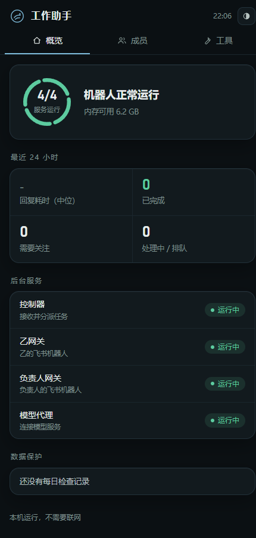
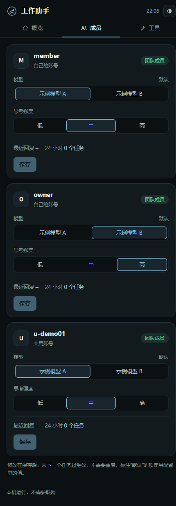

# 几分钟本地最小示例

我建议先跑这个，再接真实平台。需要 Python 3.12 或更新版本；最小演示只用标准库，不安装飞书 SDK，也不用模型账号。下面是标准 Python 命令；Windows 也可以把 `python` 换成 `py -3`。离线演示、核心检查和完整测试已在 Windows 与 Linux 验证，结果见 [测试说明](testing.md)。

## 1. 拿到代码

```sh
git clone https://github.com/suanrongbaicai/loom-team-ai.git
cd loom-team-ai
python --version
```

也可以下载仓库 ZIP。不要把自己原来的数据库、配置或登录目录复制进来。

## 2. 跑一遍记录和交付

```sh
python examples/local_demo.py
```

演示用固定 `MockModel` 提供合成文字，用真实 `loom.control.Control` 保存原件、CL 和 Context，生成并领取 outbox，再由 `MockTransport` 返回标注为 mock 的本地回执。它不理解任意自然语言，不代表真实模型完成了推理，也没有把消息发给任何人。

你会看到：

1. 成员 A 的合成介绍进入 Data。
2. CL 保存这件事的经过，Context 保存当前职责。
3. 回复先保存，之后显示 `sent（本地 mock）`。
4. 新任务读到已有档案。
5. 成员 B 在共享关闭时被拒绝；模拟明确批准后可以读到；关闭后再次拒绝。
6. 发送状态不明的另一条回复保留 `unknown`，重复发送被拒绝。

默认临时目录在运行结束时清理。想查看实际文件和数据库结构，用一个**新的空目录**：

```sh
python examples/local_demo.py --output .demo-work/first-run
```

`demo-result.json` 是演示摘要；实际原件和档案在成员目录，SQLite 在 `control/`。这些文件已被 Git 忽略，不属于公开源码。再次运行换新目录；脚本拒绝覆盖已有文件。

## 3. 运行核心检查

```sh
python tools/run_tests.py --quick
```

它检查身份/资料边界、记录与发送、bot/共享模型资源的并发条件、共享开关、链接与凭据守卫，以及这个演示。运行器拒绝外部 socket 连接，只允许本地测试接口。

## 4. 看现有维护页

```sh
python framework/tools/panel_web.py serve --demo --port 18753
```

浏览器打开 `http://127.0.0.1:18753/`，看概览和成员页。这里使用合成人员、模拟服务和示例模型名，按钮不会启动真实服务、调用模型或执行真实备份。看完按 Ctrl+C 关闭这个命令。





这是现有维护页的实际截图，不是准备中的新控制台设计。截图全部来自 `--demo`；其中资源、模型和服务状态为模拟值。

接真实平台前，请继续读 [共享策略](sharing.md)、[当前限制](status.md) 和 `framework/factory/` 的空模板。配置身份、范围与凭据之后仍须独立验收。
